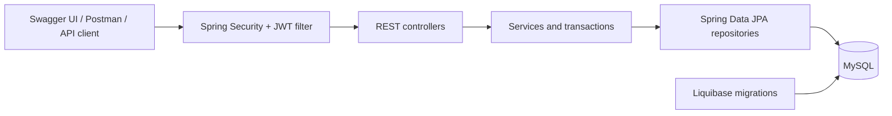

# Online Book Store

A Spring Boot REST API that takes a reader from discovering a book to placing an order.

This project models the backend of an online bookstore: customers can explore a categorized catalog, build a personal shopping cart, and keep track of their orders, while administrators manage books, categories, and order statuses. Built as a portfolio project, it brings together authentication, relational data modeling, and transactional business logic in one application.

## Features

- **Authentication:** registration, BCrypt password hashing, and stateless JWT login. Every registered customer receives the `USER` role and a shopping cart.
- **Book catalog:** paginated and sorted listings, book details, and filtering by title, author, or ISBN. Administrators can create, update, and soft-delete books.
- **Categories:** browse categories and their books; administrators maintain the category catalog.
- **Shopping cart:** add books, change quantities, and remove items. Adding the same book again increases its quantity.
- **Checkout:** create an order from a nonempty cart, save the price of each book at checkout, calculate the total, and clear the cart within a transaction.
- **Order history:** customers can access their own orders and order items; administrators can update an order's status.
- **API documentation:** interactive Swagger UI with bearer-token authentication.

The application provides a backend API; a storefront UI and payment processing are outside its current scope.

## Technology stack

| Technology | Purpose |
| --- | --- |
| Java 17, Maven | Language, dependency management, and build |
| Spring Boot 3.2.5, Spring Web | Application configuration and REST endpoints |
| Spring Security, JJWT 0.11.5 | Role-based authorization and JWT authentication |
| Spring Data JPA, Hibernate | Persistence, pagination, and dynamic query specifications |
| MySQL 8 | Relational database |
| Liquibase | Versioned database schema and initial roles/admin record |
| Jakarta Bean Validation | Request validation, including custom ISBN and password-match validators |
| MapStruct 1.5.5.Final, Lombok | DTO mapping and reduced boilerplate |
| springdoc-openapi 2.6.0 | OpenAPI specification and Swagger UI |
| Docker, Docker Compose | Containerized application and database |
| JUnit 5, Mockito, MockMvc, Testcontainers | Unit and integration testing |
| JaCoCo, Checkstyle | Coverage reporting and code-style checks |

## Architecture



Controllers handle HTTP requests, services implement business rules, and repositories manage persistence. DTOs and MapStruct mappers separate API payloads from JPA entities. The main domain relationships are users and roles, books and categories, user shopping carts and cart items, and orders with order items.

## Getting started

### Option 1: Docker Compose

**Requirements:** Git, Docker Engine or Docker Desktop, and Docker Compose v2. The Dockerfile builds the application with Maven and Java 17, so a local JDK is not required for this option.

1. Clone the repository:

   ```bash
   git clone https://github.com/egorkharaim/online-book-store.git
   cd online-book-store
   ```

2. Create a `.env` file in the project root with the following values. Replace the example passwords before starting:

   ```dotenv
   MYSQL_DATABASE=online_book_store
   MYSQL_USER=bookstore
   MYSQL_PASSWORD=change_me_app_password
   MYSQL_ROOT_PASSWORD=change_me_root_password
   MYSQLDB_LOCAL_PORT=3307
   MYSQLDB_DOCKER_PORT=3306
   SPRING_LOCAL_PORT=8080
   SPRING_DOCKER_PORT=8080
   DEBUG_PORT=5005
   ```

   Use these exact variable names: the current `.env.sample` uses different database variable names and does not include every variable required by `docker-compose.yml`. The local database port is `3307` to avoid conflicting with a MySQL server on `3306`. Keep `.env` out of version control.

3. Build and start the services:

   ```bash
   docker compose up --build -d
   docker compose logs -f app
   ```

   Wait for the Spring Boot startup message. Liquibase creates the schema automatically. On the first run, MySQL initialization can take longer than application startup; the app is configured to restart on failure.

4. Open the API documentation:

   - [Swagger UI](http://localhost:8080/api/swagger-ui/index.html)
   - [OpenAPI JSON](http://localhost:8080/api/v3/api-docs)

   The base URL is `http://localhost:8080/api`. If you change `SPRING_LOCAL_PORT`, update the URLs accordingly. The root URL does not serve a web storefront.

To stop the services while preserving database data:

```bash
docker compose down
```

MySQL data is stored in the `mysql_data` volume. Database initialization variables apply when that volume is first created; changing a password in `.env` does not update an existing database account.

### Option 2: Run locally with Maven

**Requirements:** JDK 17, Maven 3.9+, and a running MySQL 8 instance. Create a database named `online_book_store` before starting the application.

Set the following environment variables in your shell or IDE run configuration:

| Variable | Example | Meaning |
| --- | --- | --- |
| `SPRING_DATASOURCE_URL` | `jdbc:mysql://localhost:3306/online_book_store` | JDBC connection URL |
| `SPRING_DATASOURCE_USERNAME` | `bookstore` | MySQL account with schema migration permissions |
| `SPRING_DATASOURCE_PASSWORD` | Your database password | MySQL account password |
| `JWT_SECRET` | A random string of at least 32 bytes | JWT signing key |
| `JWT_EXPIRATION` | `300000` | Token lifetime in milliseconds; defaults to five minutes |

If you use the MySQL service from Docker Compose, connect to port `3307` with the credentials from `.env`. Start only that service with `docker compose up -d mysqldb`.

For example, in PowerShell:

```powershell
$env:SPRING_DATASOURCE_URL = 'jdbc:mysql://localhost:3307/online_book_store?allowPublicKeyRetrieval=true&useSSL=false'
$env:SPRING_DATASOURCE_USERNAME = 'bookstore'
$env:SPRING_DATASOURCE_PASSWORD = 'change_me_app_password'
$env:JWT_SECRET = ([guid]::NewGuid().ToString('N') + [guid]::NewGuid().ToString('N'))
$env:JWT_EXPIRATION = '300000'
mvn spring-boot:run
```

Maven/Spring Boot does not automatically load the Compose `.env` file. Set the variables explicitly. The local example disables SSL for a local database connection.

The development Compose file passes database variables to the application, but does not forward `JWT_SECRET` or `JWT_EXPIRATION`; simply adding those names to `.env` will not override the application's defaults in that setup. For deployment configuration, see [AWS deployment instructions](AWS_DEPLOY.md) and [the deployment Compose file](compose.aws.yaml).

## Try the API

Use Swagger UI or Postman to follow this workflow. Request bodies below use JSON with `Content-Type: application/json`.

### 1. Register a customer

`POST /api/auth/registration`

```json
{
  "email": "reader@example.com",
  "password": "ReaderPass123",
  "repeatPassword": "ReaderPass123",
  "firstName": "Alex",
  "lastName": "Reader",
  "shippingAddress": "10 Book Street"
}
```

Passwords must contain 8–20 characters, and the confirmation must match. Registration creates a customer account; it does not return a JWT.

### 2. Log in and authorize requests

`POST /api/auth/login`

```json
{
  "email": "reader@example.com",
  "password": "ReaderPass123"
}
```

Copy the `token` from the response. In Swagger UI, click **Authorize** and paste the token. In Postman, choose **Bearer Token** in the Authorization tab. Other API clients should send:

```http
Authorization: Bearer <token>
```

Log in again when the token expires. Catalog endpoints also require authentication.

### 3. Populate the catalog as an administrator

A fresh database contains roles and a seeded administrator record, but no books or categories. The migration stores the administrator's password as a BCrypt hash; no plaintext demo password is documented here.

For a local demo, register a separate account such as `catalog-admin@example.com`, then grant it the `ADMIN` role using a database client:

```sql
INSERT INTO users_roles (user_id, role_id)
SELECT u.id, r.id
FROM users u CROSS JOIN roles r
WHERE u.email = 'catalog-admin@example.com'
  AND r.name = 'ADMIN'
  AND NOT EXISTS (
      SELECT 1 FROM users_roles ur
      WHERE ur.user_id = u.id AND ur.role_id = r.id
  );
```

Log in with that account and authorize it in Swagger UI. Create a category with `POST /api/categories`:

```json
{
  "name": "Fiction",
  "description": "Novels and stories"
}
```

Then create a book with `POST /api/books`, replacing `categoryIds` with the ID returned above:

```json
{
  "title": "The Hobbit",
  "author": "J.R.R. Tolkien",
  "isbn": "9780547928227",
  "price": 19.99,
  "description": "An adventure through Middle-earth.",
  "categoryIds": [1]
}
```

### 4. Browse, add to cart, and check out

Authorize as the customer again. Browse with `GET /api/books?page=0&size=10&sort=title,asc`, then add a book using `POST /api/cart`:

```json
{
  "bookId": 1,
  "quantity": 2
}
```

Use the actual book ID returned when creating the book. View the cart with `GET /api/cart`, then place an order with `POST /api/orders`:

```json
{
  "shippingAddress": "10 Book Street"
}
```

The order starts with status `PENDING`. Retrieve it through `GET /api/orders`; the cart is cleared after checkout.

## Controller reference

All paths below are relative to `/api`. `USER` and `ADMIN` are independent roles: an account with only `ADMIN` cannot call endpoints that explicitly require `USER`.

| Controller | Method and path | Function | Access |
| --- | --- | --- | --- |
| Authentication | `POST /auth/registration` | Register a customer and create a cart | Public |
| Authentication | `POST /auth/login` | Obtain a JWT | Public |
| Book | `GET /books` | List books with pagination and sorting | USER or ADMIN |
| Book | `GET /books/{id}` | Get book details | USER or ADMIN |
| Book | `GET /books/search` | Filter by `titles`, `authors`, and `isbns` | USER or ADMIN |
| Book | `POST /books` | Create a book | ADMIN |
| Book | `PUT /books/{id}` | Update a book | ADMIN |
| Book | `DELETE /books/{id}` | Soft-delete a book | ADMIN |
| Category | `GET /categories` | List categories with pagination | Authenticated |
| Category | `GET /categories/{id}` | Get category details | Authenticated |
| Category | `GET /categories/{id}/books` | List books in a category | Authenticated |
| Category | `POST /categories` | Create a category | ADMIN |
| Category | `PUT /categories/{id}` | Update a category | ADMIN |
| Category | `DELETE /categories/{id}` | Delete a category | ADMIN |
| Shopping cart | `GET /cart` | Get the current user's cart | USER |
| Shopping cart | `POST /cart` | Add a book or increase its quantity | USER |
| Shopping cart | `PUT /cart/items/{cartItemId}` | Set an item's quantity | USER |
| Shopping cart | `DELETE /cart/items/{cartItemId}` | Remove a cart item | USER |
| Order | `POST /orders` | Place an order from the cart | USER |
| Order | `GET /orders` | Get personal order history with pagination | USER |
| Order | `GET /orders/{orderId}/items` | List items from a personal order with pagination | USER |
| Order | `GET /orders/{orderId}/items/{itemId}` | Get a personal order item | USER |
| Order | `PATCH /orders/{id}` | Update an order's status | ADMIN |

Search uses exact values rather than partial text matching, for example `/api/books/search?titles=The%20Hobbit`. Supported order status values are `PENDING`, `DELIVERED`, `COMPLETED`, and `CANCELED`. A status update body looks like `{"status":"DELIVERED"}`; a cart quantity update looks like `{"quantity":3}`.

### Use with Postman

Import `http://localhost:8080/api/v3/api-docs` into Postman using **Import → Link** to generate requests from the running API's OpenAPI definition. Set bearer authentication with the login token for protected requests. No separate Postman collection is included in this repository.

## Testing and code quality

With JDK 17, Maven, and Docker running:

```bash
mvn clean verify
```

The suite includes book and category service unit tests, MockMvc controller tests, a book repository test, and an application-context test. Database integration tests use a MySQL Testcontainer and Liquibase migrations. Docker-dependent tests are configured to skip when Docker is unavailable; a successful build without Docker therefore does not demonstrate that those integration tests passed.

Checkstyle runs during compilation. JaCoCo generates its HTML report at `target/site/jacoco/index.html` after tests run.

To build a runnable JAR without executing tests:

```bash
mvn clean package -DskipTests
java -jar target/online-book-store-0.0.1-SNAPSHOT.jar
```

Set the same database and JWT environment variables before running the JAR. The Docker image build also skips test execution; run verification separately.

## Engineering challenges and solutions

- **Keeping checkout consistent:** order creation, item price snapshots, total calculation, and cart clearing share a transaction. This keeps the checkout steps together and preserves purchase-time prices when catalog prices change later.
- **Restricting access to personal data:** cart operations resolve the authenticated user's cart, and order queries check ownership rather than trusting a client-supplied user ID. Method-level security separates catalog administration from customer operations.
- **Supporting optional search criteria:** JPA Specifications compose title, author, and ISBN filters instead of requiring a repository method for every combination.
- **Managing schema changes across environments:** Liquibase tracks migrations, Hibernate validates the resulting schema, and Testcontainers provides MySQL-backed integration tests.
- **Removing books without deleting their records:** Hibernate soft deletion marks books as deleted and excludes them from normal catalog queries.
